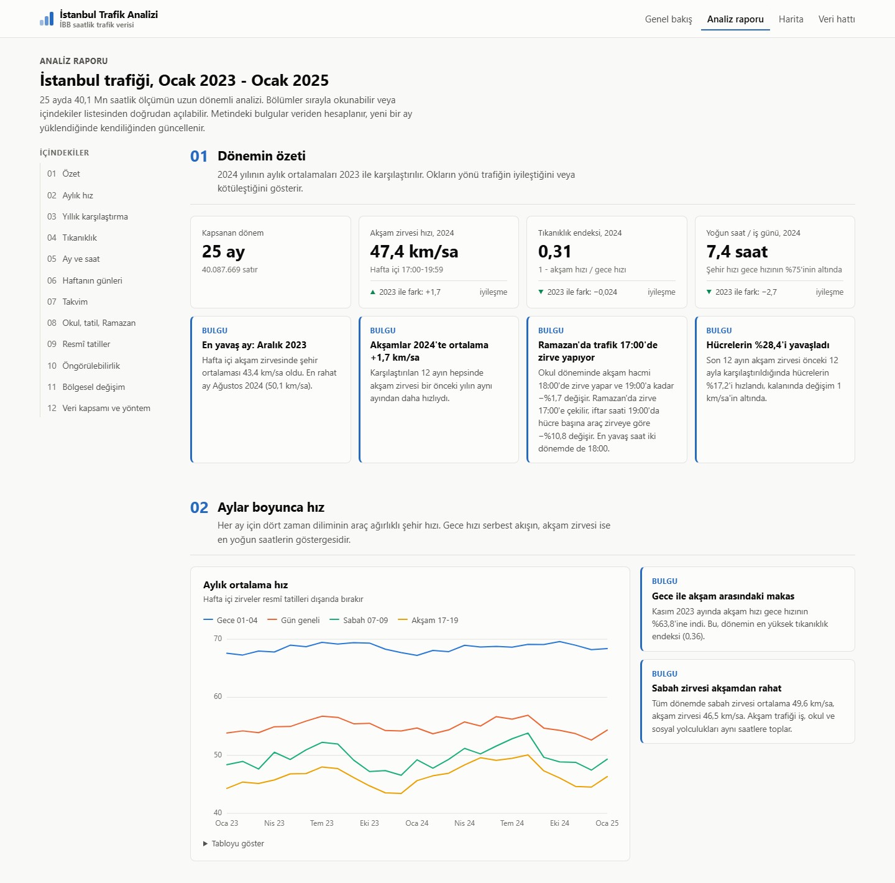
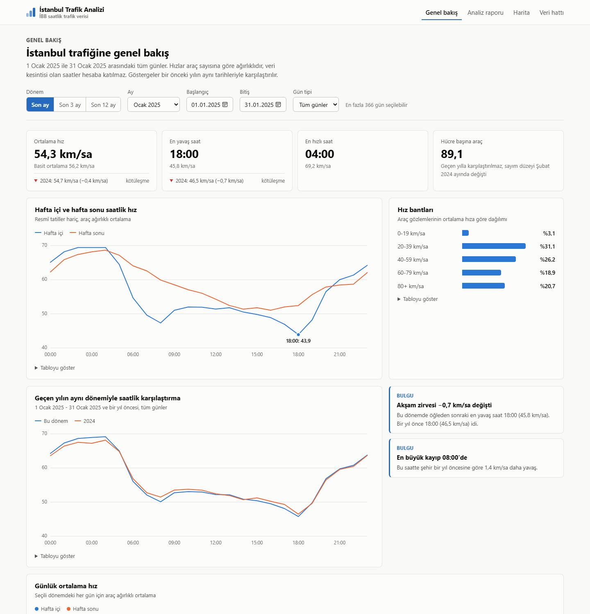
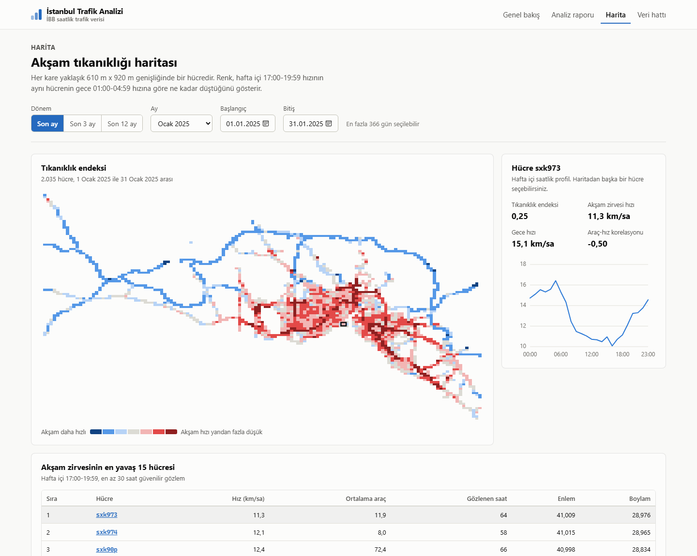
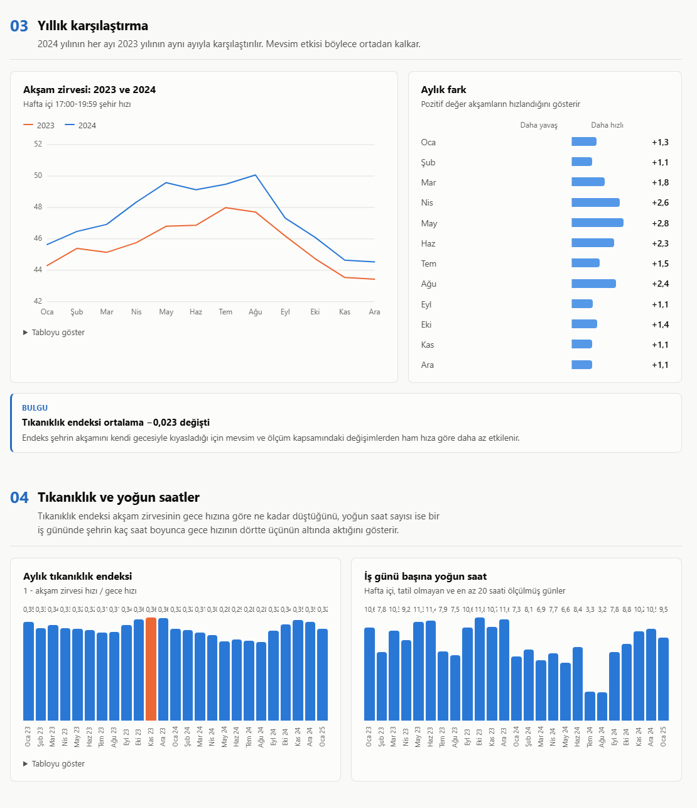
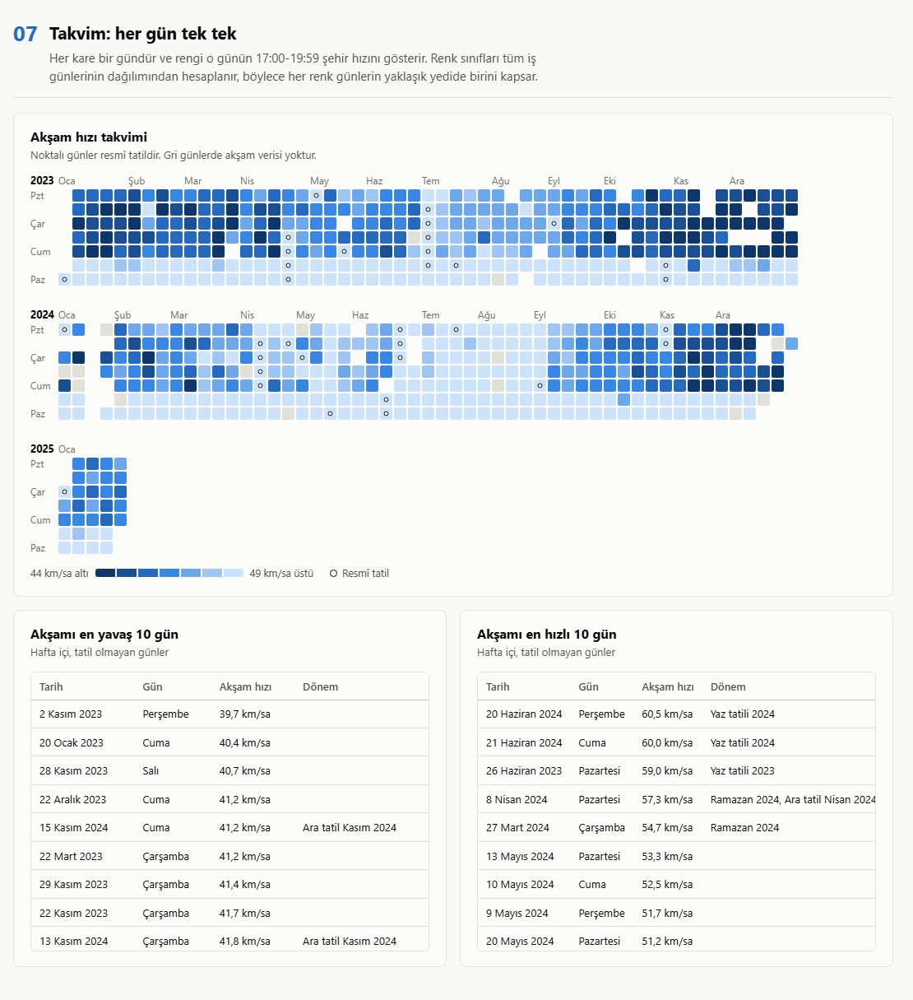
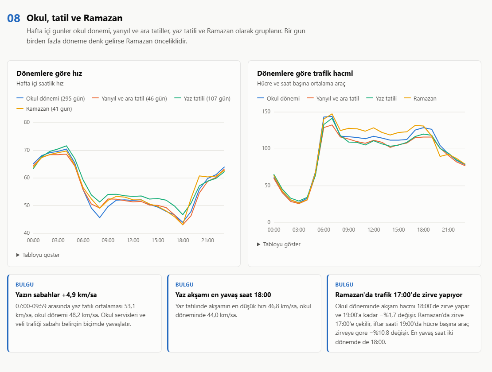
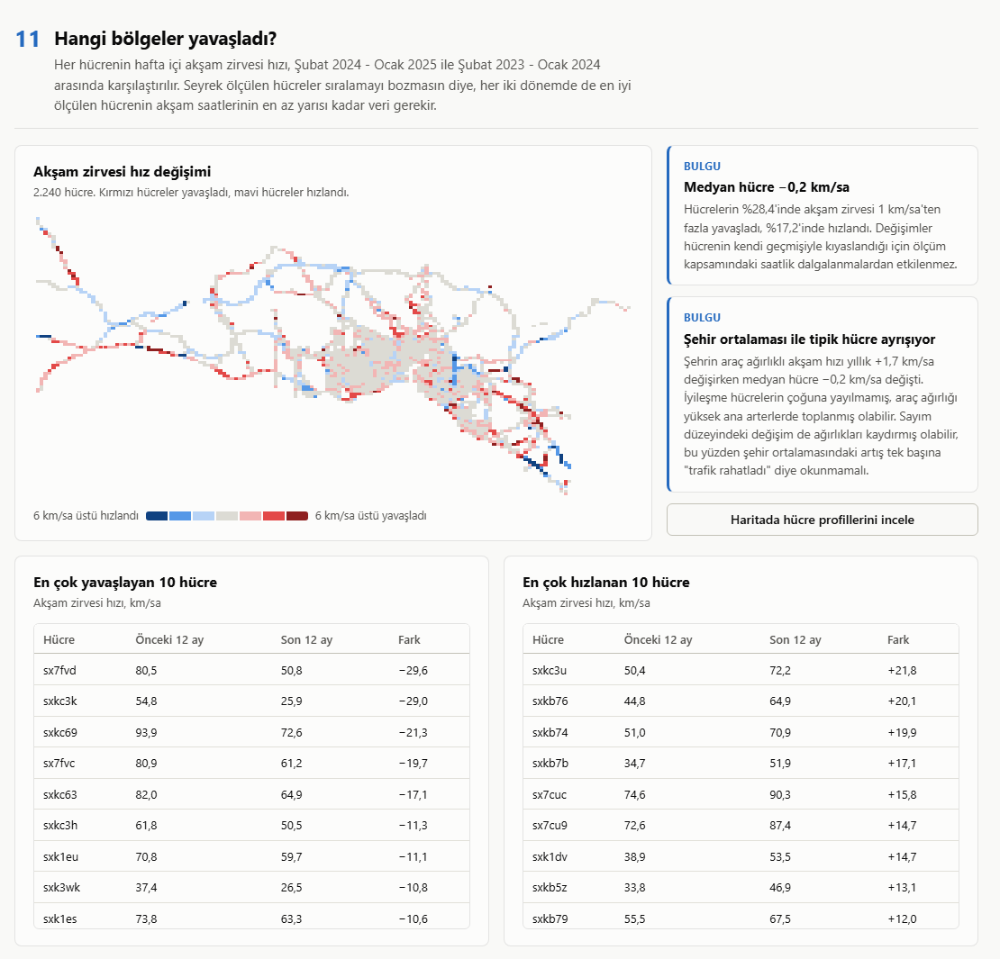
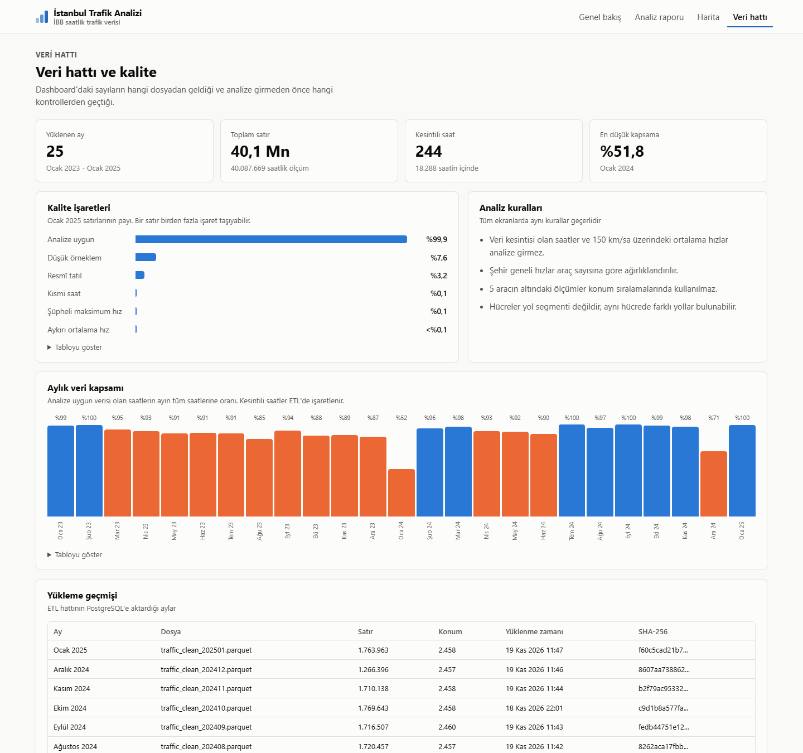
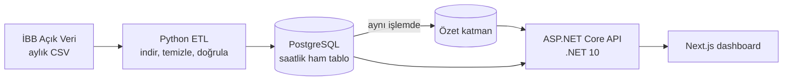

# Istanbul Traffic Analytics

[](https://github.com/rasimataberksahin/istanbul-traffic-analytics/actions/workflows/ci.yml)

İBB açık verisindeki saatlik trafik ölçümlerini indiren, temizleyen, PostgreSQL'de modelleyen, .NET API ile sunan ve Next.js arayüzünde analiz eden uçtan uca veri projesi.



| | |
|---|---|
| **Veri** | Ocak 2023 - Ocak 2025, 25 ay, 40,1 milyon saatlik ölçüm, 2.464 konum hücresi |
| **Hat** | Python ETL → PostgreSQL yıldız şema ve özet katman → ASP.NET Core API → Next.js dashboard |
| **Kalite** | 256 otomatik test, GitHub Actions CI, tek komutla Docker Compose |

## Öne çıkan bulgular

| Bulgu | Değer |
|---|---|
| Araç ağırlıklı şehir ortalamasına göre 2024'te akşamlar 12 ayın 12'sinde hızlandı | 45,7 → 47,4 km/sa |
| Ama hücre ağırlıkları 2023'e sabitlenince bu hızlanma kayboluyor: 12 ayın yalnızca 2'sinde hızlanma var | 45,6 → 45,2 km/sa |
| Medyan hücre de aynı sonucu veriyor; hücre bazında son 12 ayda hücrelerin %28,5'i 1 km/sa'ten fazla yavaşladı | 44,8 → 44,4 km/sa |
| Yaz tatilinde sabah zirvesi okul dönemine göre daha rahat | +4,9 km/sa |
| Ramazan'da akşam hacmi 18:00 yerine 17:00'de zirve yapar, iftar saatinde düşer | Zirveye göre −%10,8 |
| 2024 Ramazan Bayramı'nda gündüz trafik hacmi olağan günlerin yarısına indi | −%54,5 |
| Haftanın en yavaş saati | Çarşamba 18:00, 43,9 km/sa |
| En öngörülemez saat: iyi ve kötü günler arasındaki fark en büyük | 08:00, 43,7-51,3 km/sa |
| 24 Ocak 2024'te hücre başına araç bir günde 1,7 katına çıktı, hızda karşılığı yok: İBB'nin sayım düzeyi değişti | 73 → 123 araç |

İlk iki satır projenin en önemli bulgusudur. Şehir ortalaması araç sayısıyla ağırlıklandırılır ve Ocak 2024'teki sayım değişikliği bu ağırlıkları kaydırdı. Hücrelerin hızı yerinde sayarken ortalamanın yükselmesi, sayım artışının en çok hızlı yollarda olduğunu ve bu yolların ortalamadaki payının büyüdüğünü düşündürür. Bu yüzden rapor yıllık karşılaştırmayı üç ölçüyle gösterir: araç ağırlıklı, ilk yılın araç paylarıyla sabit ağırlıklı ve medyan hücre. Sonuç: veriye göre 2024'te İstanbul'un akşam trafiği rahatlamadı. Dashboard sayım kırılmasını veriden tespit eder ve kırılmanın iki yanı arasında hacim karşılaştırmaz. Ayrıntılı hesap [uzun dönem notebook'undadır](notebooks/02_long_term_trends.ipynb).

Bulguların tamamı dashboard'daki 12 bölümlük [analiz raporundadır](docs/dashboard.md#analiz-raporu-bölümleri). Rapor metni veriden hesaplanır, yeni bir ay yüklendiğinde kendiliğinden güncellenir.

## Ekranlar

| Genel bakış | Tıkanıklık haritası |
|---|---|
|  |  |

| Yıllık karşılaştırma | Takvim |
|---|---|
|  |  |

| Okul, tatil ve Ramazan | Bölgesel değişim |
|---|---|
|  |  |

| Veri hattı | |
|---|---|
|  | |

## Mimari



| Katman | Teknoloji | Projedeki görevi |
|---|---|---|
| Veri işleme | Python, Pandas, PyArrow | Parça parça okuma, karantina, kalite işaretleri, deterministik Parquet |
| Veritabanı | PostgreSQL 18, SQL | Aylık bölümlenmiş yıldız şema, özet tablolar, CTE ve pencere fonksiyonları |
| Backend | C#, .NET 10, ASP.NET Core | Katmanlı REST API, RFC 9457 hatalar, önbellek, hız sınırı |
| Veri erişimi | Dapper, Npgsql, EF Core | Analitik SQL için Dapper, yönetim tabloları ve migration için EF Core |
| Frontend | Next.js 16, TypeScript, React 19 | Sunucu bileşenleri, URL'de filtreler, harici kütüphanesiz SVG grafikler |
| Altyapı | Docker, Docker Compose | Veritabanı, API, dashboard ve ETL için imajlar |
| Kalite | pytest, xUnit, Testcontainers, Vitest, GitHub Actions | Birim, entegrasyon ve imaj derleme kontrolleri |

Teknoloji kararlarının gerekçeleri [mimari dokümanındadır](docs/architecture.md).

## Hızlı başlangıç

Gereksinim: Docker. `.env.example` dosyasını `.env` adıyla kopyalayın ve parola ile API anahtarını değiştirin.

Veritabanını, API'yi ve dashboard'u derleyip başlatır:

```bash
docker compose up -d --build
```

Bir ayı indirir, temizler ve yükler. Aralık genişletilebilir, örneğin `--from 2023-01 --to 2025-01`:

```bash
docker compose --profile etl run --rm etl --from 2024-10 --to 2024-10
```

Dashboard `http://localhost:3000`, API `http://localhost:5088/openapi/v1.json` adresindedir. Veri hattı ekranındaki yükleme geçmişi için yükleme sonrası eşitleme çağrısı yapılır:

```bash
curl -X POST -H "X-Api-Key: <.env içindeki Admin__ApiKey>" http://localhost:5088/api/v1/pipeline/sync
```

Ham CSV ve Parquet dosyaları depoya eklenmez. Yukarıdaki komut aynı dosyaları kaynaktan yeniden üretir ve SHA-256 özetiyle doğrular.

## Yerel geliştirme

Gereksinimler: Python 3.12, .NET 10 SDK, Node.js 24 ve Docker.

```bash
docker compose up -d --wait postgres
```

```bash
python -m venv .venv
```

```bash
.venv/Scripts/python -m pip install -e "./etl[dev,eda]"
```

```bash
.venv/Scripts/python -m traffic_etl.run --from 2024-10 --to 2024-10
```

API, `backend` klasöründe:

```bash
dotnet run --project src/IstanbulTraffic.Api
```

Dashboard, `frontend` klasöründe:

```bash
npm ci
```

```bash
npm run dev
```

## Veri hattı

Ham CSV parça parça okunur. Geçersiz satırlar nedeniyle karantinaya alınır, şüpheli ama geçerli satırlar silinmeden işaretlenir. Veri kesintisi olan saatler ayın kendi düzenine göre tespit edilir. Çıktı yalnızca veri sözleşmesini geçerse yayımlanır.

| 25 ay | Sonuç |
|---|---:|
| Ham satır | 40.087.669 |
| Karantina | 0 |
| Kesintili saat | 244 / 18.288 |
| Yükleme | Ay başına tek işlem, kaynakla satır ve araç toplamı karşılaştırması |

Ayrıntılar: [ETL hattı](docs/etl-pipeline.md) · [Veri sözlüğü](docs/data-dictionary.md) · [Kalite raporu](docs/data-quality-report-2024-10.md)

## Veritabanı ve SQL

Ham saatlik tablo aylık bölümlere ayrılır. Yükleyici her ayı yazdıktan sonra aynı işlemde üç özet tabloyu yeniler: şehir geneli saatlik toplamlar, hız bantları ve hücre bazında günlük toplamlar. Şehir geneli bir yıllık sorgu ham tablo yerine özet katmandan okunduğunda yanıt süresi 5.397 ms'den 5,6 ms'ye iner, sonuç birebir aynıdır.

[`database/analysis`](database/analysis) altındaki 17 sorgu JOIN, CTE, `FILTER`, `LAG`, `RANK` ve yüzdelik fonksiyonlarını kullanır.

Ayrıntılar: [Veritabanı tasarımı](docs/database.md) · [Ekim 2024 SQL analizi](docs/sql-analysis-2024-10.md)

## REST API

.NET 10 ile yazılan katmanlı API 21 endpoint sunar: anlık filtreli analizler, 25 ayı kapsayan uzun dönem analizleri, konum analizleri ve veri hattı yönetimi.

- **Dapper / Npgsql:** Özet katman ve ham tablo üzerinde elle yazılmış analitik SQL
- **EF Core:** `admin` şemasındaki yönetim tabloları ve migration'lar
- **Middleware:** Correlation ID, RFC 9457 hata yanıtları, hız sınırı, output cache, sıkıştırma ve güvenlik başlıkları
- **Testler:** Testcontainers ile gerçek PostgreSQL üzerinde çalışan entegrasyon testleri. Uzun dönem analizlerinin beklenen değerleri elle hesaplanmıştır.

Ayrıntılar: [API dokümanı](docs/api.md)

## Dashboard

| Ekran | İçerik |
|---|---|
| Genel bakış | Seçilen dönemin göstergeleri, önceki yılın aynı tarihleriyle fark, saatlik ve günlük hız |
| Analiz raporu | 12 bölüm: aylık trend, yıllık karşılaştırma, mevsimsellik, takvim, okul ve Ramazan dönemleri, tatiller, öngörülebilirlik, bölgesel değişim |
| Harita | 2.000'i aşkın hücrenin akşam tıkanıklığı, semt ve ilçe araması, ilçe sıralaması, semt profili |
| Veri hattı | Aylık kapsama, kalite işaretleri, yükleme geçmişi |
| Kılavuz | Ekranların, kontrollerin ve kavramların açıklaması |

Arayüz Türkçe ve İngilizce kullanılabilir; açık, koyu ve sistem teması vardır. Her kartın köşesindeki "i" düğmesi o kartın nasıl okunacağını anlatır.

Ayrıntılar: [Dashboard dokümanı](docs/dashboard.md)

## Testler

| Bileşen | Araç | Test |
|---|---|---:|
| ETL | pytest, geçici PostgreSQL veritabanları | 94 |
| Backend | xUnit v3, Testcontainers | 85 |
| Frontend | Vitest | 77 |

GitHub Actions her push ve pull request'te üç test grubunu, lint ve tip kontrolünü, üretim derlemesini ve üç Docker imajının derlenmesini çalıştırır.

## Notebook'lar

İki Jupyter notebook, kodu ve çıktılarıyla birlikte GitHub'da doğrudan okunabilir:

| Notebook | Kapsam | Öne çıkan bulgu |
|---|---|---|
| [01 Keşifsel analiz](notebooks/01_exploratory_analysis.ipynb) | Ekim 2024, tek ay | Toplu korelasyon hücre içi ilişkiyi gizliyor (Simpson paradoksu), dashboard'daki korelasyon bu yüzden hücre bazında |
| [02 Uzun dönem analizi](notebooks/02_long_term_trends.ipynb) | Ocak 2023 - Ocak 2025, 25 ay | Araç sayımı 24 Ocak 2024'te 1,68 katına çıktı. Ağırlıklar sabitlendiğinde 2024'teki +1,65 km/sa'lik akşam hızlanması -0,32 km/sa'e döner |

İkinci notebook 40 milyon satırı ham parquet dosyalarından pandas ile işler ve sonuçlarını SQL analizlerinin çıktılarıyla karşılaştırır. 11 kontrolün hepsi yuvarlama payı içinde eşleşir. Ekim 2024 bulguları ayrıca [EDA raporunda](docs/eda-report-2024-10.md) özetlenmiştir.

Notebook'ları yeniden çalıştırmak için önce ETL ile ilgili ayların parquet dosyaları üretilmelidir:

```bash
.venv/Scripts/python -m jupyter nbconvert --to notebook --execute --inplace notebooks/02_long_term_trends.ipynb
```

## Bilinen sınırlamalar

- Veri geohash hücreleri üzerindedir. Bir hücrede birden fazla yol olabilir, sonuçlar yol segmenti düzeyinde değildir.
- Her saatte veri gönderen hücre sayısı 1.204 ile 2.434 arasında değişir. Hacim bu yüzden toplam araçla değil, hücre ve saat başına ortalama araçla karşılaştırılır. Bölgesel değişimde her hücre kendi geçmişiyle kıyaslanır.
- Resmî tatil takvimi 2023-2025 için tanımlıdır. Daha eski bir ay yüklenmek istendiğinde ETL açık bir hata verir.
- Okul ve Ramazan tarihleri takvim tablosuna elle girilmiştir.

## Lisans ve kaynak

Veriler [İBB Açık Veri Lisansı](https://data.ibb.gov.tr/license) kapsamında İstanbul Büyükşehir Belediyesi tarafından yayımlanmaktadır.
