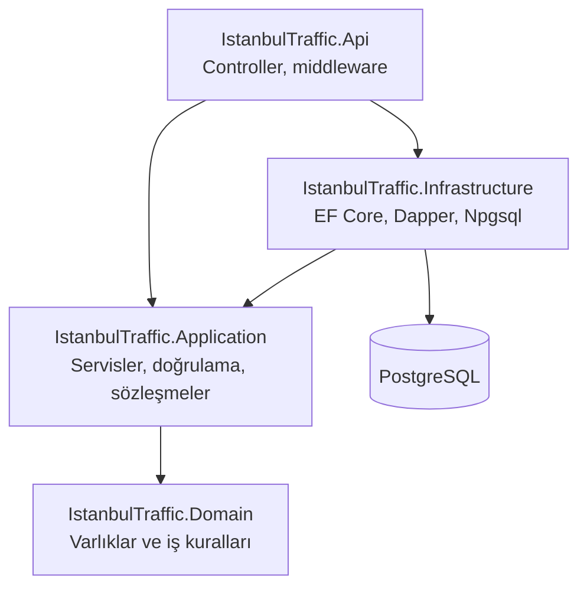

# REST API

ASP.NET Core (.NET 10) ile geliştirilen API, PostgreSQL'deki trafik analizlerini dashboard'a sunar.

```bash
cd backend
```

```bash
dotnet run --project src/IstanbulTraffic.Api
```

API `http://127.0.0.1:5088` adresinde çalışır. OpenAPI dokümanı `/openapi/v1.json` adresindedir. Geliştirme ortamında bağlantı bilgileri kök dizindeki `.env` dosyasından okunur ve yönetim tablolarının migration'ı otomatik uygulanır.

## Katmanlar



| Katman | Sorumluluk |
|---|---|
| Domain | `ImportRun` gibi varlıklar ve analiz kuralları. Dış bağımlılığı yoktur |
| Application | İstek doğrulama, iş akışları ve repository arayüzleri |
| Infrastructure | Dapper analitik sorguları, EF Core yönetim tabloları |
| Api | HTTP sözleşmesi, hata yönetimi, önbellek ve güvenlik |

## EF Core ve Dapper ayrımı

| Şema | Araç | İçerik |
|---|---|---|
| `traffic` | Dapper / Npgsql | 40 milyon satırlık ham tablo ve özet katman üzerinde elle yazılmış analitik SQL |
| `admin` | EF Core + migration | `data_sources`, `import_runs`, `quality_results` |

`POST /api/v1/pipeline/sync`, ETL'in `traffic.load_audit` tablosundaki yükleme geçmişini ve kalite sayılarını yönetim tablolarına aktarır. İşlem tekrar çalıştırılabilir ve analitik önbelleğini temizler.

## Endpoint'ler

### Trafik analizi

| Yöntem | Yol | Açıklama |
|---|---|---|
| GET | `/api/v1/metadata` | Veri aralığı, yüklü aylar ve filtre seçenekleri |
| GET | `/api/v1/traffic/summary` | Genel göstergeler, en yavaş ve en hızlı saat |
| GET | `/api/v1/traffic/hourly-profile` | Saatlik hız ve araç gözlemi |
| GET | `/api/v1/traffic/daily-trend` | Günlük hız ve tatil bilgisi |
| GET | `/api/v1/traffic/heatmap` | Gün ve saat bazında hız |
| GET | `/api/v1/traffic/day-type-comparison` | Hafta içi ve hafta sonu karşılaştırması |
| GET | `/api/v1/traffic/speed-bands` | Hız bantlarının araç gözlemi payı |

Şehir geneli uçlar ham tablo yerine `traffic.agg_city_hourly` ve `traffic.agg_city_speed_band` özetlerini okur. Bu yüzden 366 günlük bir aralık bile milisaniyeler içinde hesaplanır.

### Uzun dönem analizleri

Bu uçlar filtre almaz ve yüklenen tüm ayları kapsar. Hepsi özet katmandan okunur.

| Yöntem | Yol | Açıklama |
|---|---|---|
| GET | `/api/v1/insights/monthly` | Her ayın hızları, tıkanıklık endeksi, yoğun saat sayısı, hacmi ve veri kapsamı. Akşam zirvesi ayrıca sabit ağırlıkla (`fixedWeightEveningSpeedKmh`) ve medyan hücreyle (`medianCellEveningSpeedKmh`) verilir |
| GET | `/api/v1/insights/month-hour` | Ay ve saat bazında hafta içi hız |
| GET | `/api/v1/insights/day-of-week` | Haftanın günü ve saat bazında hız ve hacim |
| GET | `/api/v1/insights/calendar` | Her gün için hız, akşam hızı ve denk geldiği takvim dönemleri |
| GET | `/api/v1/insights/periods` | Okul dönemi, okul tatilleri, yaz tatili ve Ramazan saatlik profilleri |
| GET | `/api/v1/insights/holidays` | Her resmî tatilin çevresindeki aynı günlere göre hız ve hacim farkı |
| GET | `/api/v1/insights/reliability` | Saat bazında günlük hızın 10, 25, 50, 75 ve 90. yüzdelikleri |
| GET | `/api/v1/insights/location-changes` | Son 12 ay ile önceki 12 ayın hücre bazında akşam zirvesi farkı |
| GET | `/api/v1/insights/weather` | Hafif yağmur, kuvvetli yağmur ve karın hız ve hacme etkisi; saatlik etki, ilçelerin yağmur hassasiyeti, en yağışlı akşamlar |

Hacim, toplam araç yerine hücre ve saat başına ortalama araçla verilir, çünkü her saatte veri gönderen hücre sayısı 1.204 ile 2.434 arasında değişir. Bölgesel değişimde bir hücre, her iki dönemde de en iyi ölçülen hücrenin akşam saatlerinin en az yarısı kadar ölçülmüşse karşılaştırılır.

### Konum analizi

| Yöntem | Yol | Açıklama |
|---|---|---|
| GET | `/api/v1/locations/slowest` | Seçilen saatlerde en yavaş hücreler |
| GET | `/api/v1/locations/congestion-map` | Harita için tıkanıklık endeksi |
| GET | `/api/v1/locations/{geohash}/profile` | Hücrenin saatlik profili ve araç-hız korelasyonu |

### Veri hattı

| Yöntem | Yol | Yetki | Açıklama |
|---|---|---|---|
| GET | `/api/v1/pipeline/data-sources` | Yok | Veri kaynakları |
| GET | `/api/v1/pipeline/import-runs` | Yok | Yüklenen aylar ve kalite sonuçları |
| POST | `/api/v1/pipeline/sync` | `X-Api-Key` | Yükleme geçmişini eşitler |

### Sağlık

| Yol | Açıklama |
|---|---|
| `/health/live` | Uygulama ayakta mı |
| `/health/ready` | Veritabanına erişilebiliyor mu |

## Sorgu parametreleri

| Parametre | Tip | Varsayılan | Kural |
|---|---|---|---|
| `from`, `to` | `yyyy-MM-dd` | Tüm veri | En fazla 366 gün |
| `dayType` | `all`, `weekday`, `weekend`, `holiday` | `all` | Hafta içi ve hafta sonu resmî tatilleri içermez |
| `startHour`, `endHour` | 0-23 | 17, 19 | Yalnızca `locations/slowest` |
| `limit` | 1-100 | 15 | Yalnızca `locations/slowest` |

Tüm analizler kısmi saatleri ve hız aykırılarını dışarıda bırakır. Konum sıralaması ve tıkanıklık haritası düşük örneklemli satırları kullanmaz ve gece ile akşam için en az 30'ar gözlem ister. Tarih verilmezse uçlar yüklenen tüm veriyi kullanır. Dashboard varsayılan olarak son yüklenen ayı ister.

## Hata biçimi

Hatalar RFC 9457 `application/problem+json` biçimindedir:

```json
{
  "title": "The request is not valid.",
  "status": 400,
  "instance": "/api/v1/traffic/summary",
  "errors": { "to": ["to must not be earlier than from."] },
  "correlationId": "client-request-1"
}
```

## İstek hattı

| Sıra | Bileşen | Görev |
|---:|---|---|
| 1 | Correlation ID | Her istek ve log kaydını izlenebilir kılar |
| 2 | Güvenlik başlıkları | `nosniff`, `DENY` ve `no-referrer` ekler |
| 3 | Hata yönetimi | İstisnaları iç ayrıntı sızdırmadan problem yanıtına çevirir |
| 4 | Sıkıştırma | Brotli ve Gzip uygular |
| 5 | CORS | Yalnızca izinli kaynaklardan GET isteği kabul eder |
| 6 | Hız sınırı | İstemci başına dakikada 120 istek |
| 7 | Output cache | Analiz yanıtlarını 10 dakika saklar |

## Doğrulama

| Kontrol | Sonuç |
|---|---|
| xUnit birim ve entegrasyon testleri | 84 test geçti |
| Entegrasyon ortamı | Testcontainers ile geçici PostgreSQL 18.6, Ekim 2023 ve Ekim 2024 tohum verisi |
| Uzun dönem analizleri | Beklenen değerler tohum verisinden elle hesaplanıp testlere yazıldı |
| Gerçek veriyle SQL karşılaştırması | 152 değerin tamamı eşleşti |
| Derleme | 0 uyarı, uyarılar hata olarak değerlendirilir |

25 ay yüklüyken, 12 aylık aralıkla yapılan yerel ölçüm:

| Uç | İlk çağrı | Önbellekten |
|---|---:|---:|
| `traffic/summary` | 837 ms | 31 ms |
| `traffic/hourly-profile` | 44 ms | 26 ms |
| `traffic/daily-trend` | 339 ms | 78 ms |
| `locations/congestion-map` | 2.968 ms | 541 ms |
| `locations/slowest` | 1.055 ms | 26 ms |
| `insights/monthly` | 126 ms | 36 ms |
| `insights/calendar` | 428 ms | 311 ms |
| `insights/location-changes` | 1.940 ms | 565 ms |

Harita ve bölgesel değişim yanıtları 2.000'i aşkın hücre taşıdığı için önbellekten dönerken de diğerlerinden büyüktür.
