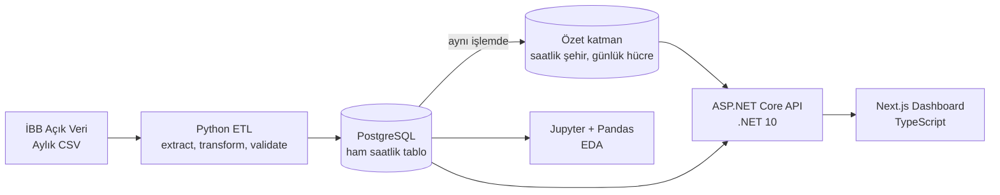

# Mimari

## Sistem akışı



## Özet katmanı

25 ayda ham tablo 40 milyonu aşan satıra ulaşır. Şehir geneli bir yıllık analiz bu tabloyu her istekte taradığında yanıtlar saniyeler sürer. Bu yüzden yükleyici her ayı yazdıktan sonra aynı veritabanı işlemi içinde üç özet tabloyu da yeniler:

| Tablo | Tanecik | Okuyan |
|---|---|---|
| `traffic.agg_city_hourly` | Şehir, saat | Genel bakış ve analiz raporundaki tüm şehir geneli sorgular |
| `traffic.agg_city_speed_band` | Şehir, saat, hız bandı | Hız bantları |
| `traffic.agg_location_daily` | Hücre, gün | Tıkanıklık haritası, bölgesel değişim, aktif hücre sayısı |

Özetler aynı işlemde yazıldığı için ham tabloyla hiçbir zaman ayrışmaz. Bir yükleme başarısız olursa iki katman birlikte geri alınır. Testler, özet toplamlarının ham tabloyla birebir aynı olduğunu doğrular. Tek bir hücrenin saatlik profili ve keyfi saat aralıklı sıralama gibi seçici sorgular ham tablodan, indeks ve bölüm budamasıyla okunur.

## Teknoloji sorumlulukları

| Teknoloji | Projedeki görevi |
|---|---|
| Python | İndirme, temizleme, doğrulama ve PostgreSQL'e yükleme |
| Pandas | Parça parça veri işleme ve keşifsel veri analizi |
| PostgreSQL | Trafik verilerinin ve yönetim tablolarının depolanması |
| SQL | JOIN, CTE, GROUP BY, pencere fonksiyonları ve indeksler |
| C# / .NET 10 | Backend ve REST API |
| ASP.NET Core | Controller, servis katmanı ve middleware |
| EF Core | Yönetim tabloları ve migration'lar |
| Dapper / Npgsql | Performans odaklı analitik sorgular |
| Next.js / TypeScript | Kullanıcı arayüzü |
| Docker | Tekrarlanabilir geliştirme ortamı |
| xUnit / pytest | Backend ve veri işleme testleri |
| GitHub Actions | Otomatik test ve CI |

## Mimari kararlar

### EF Core ve Dapper birlikte kullanılır

İki araç farklı iş yüklerine hizmet eder ve aynı tabloları paylaşmaz.

| Şema | Sahibi | Erişim | İçerik |
|---|---|---|---|
| `admin` | EF Core migration'ları | EF Core | Veri kaynakları, ETL çalıştırmaları, kalite sonuçları |
| `traffic` | Sürümlü SQL script'leri | Dapper / Npgsql | Konum boyutu, takvim boyutu, saatlik trafik gerçekleri |

Yönetim tabloları CRUD ağırlıklıdır ve EF Core'un değişiklik takibinden yararlanır. Analitik sorgular ise milyonlarca satır üzerinde CTE ve pencere fonksiyonları kullandığı için SQL'in açıkça yazılması gerekir.

### Python ve .NET veritabanı üzerinden ayrışır

ETL ve API birbirini doğrudan çağırmaz. Python veriyi yazar, .NET okur. Böylece iki taraf bağımsız test edilip dağıtılabilir.

### Ham veri değiştirilmez

`data/raw` altındaki dosyalar kaynakla birebir aynı kalır ve SHA-256 özetiyle kayıt altına alınır. Sorunlu satırlar silinmez, kalite işaretleriyle ayrılır. Her karar geriye dönük izlenebilir.

### Kafka, Spark ve Kubernetes kullanılmaz

Aylık yaklaşık 1,8 milyon satır tek PostgreSQL sunucusu için küçük bir hacimdir. Bu araçlar mevcut ihtiyaca karşılık gelmeyen operasyonel yük getirir.

## Depo yapısı

```text
istanbul-traffic-analytics/
├── .github/workflows/          # CI: pytest, xUnit, frontend, Docker imajları
├── backend/
│   ├── src/
│   │   ├── IstanbulTraffic.Api/             # Controller, middleware, OpenAPI
│   │   ├── IstanbulTraffic.Application/     # Servisler, DTO'lar, arayüzler
│   │   ├── IstanbulTraffic.Domain/          # Varlıklar ve iş kuralları
│   │   └── IstanbulTraffic.Infrastructure/  # EF Core, Dapper, Npgsql
│   └── tests/
│       ├── IstanbulTraffic.UnitTests/
│       └── IstanbulTraffic.IntegrationTests/
├── database/
│   ├── schema/                 # traffic şeması, takvim dönemleri, özet katman
│   └── analysis/               # Analitik SQL sorguları
├── data/
│   ├── raw/                    # Git'e eklenmez, manifest'ler hariç
│   └── processed/              # Git'e eklenmez
├── docs/
├── etl/
│   ├── src/traffic_etl/
│   └── tests/
├── frontend/                   # Next.js + TypeScript, Dockerfile
├── notebooks/
├── docker-compose.yml          # postgres, api, web ve isteğe bağlı etl
└── README.md
```

## Yol haritası

Bir aşamanın çıktıları tamamlanmadan sonrakine geçilmez.

| Aşama | Konu | Çıktı | Durum |
|---|---|---|---|
| 1 | Veriyi bulma ve inceleme | İndirme kodu, profil, veri sözlüğü, kalite raporu | Tamamlandı |
| 2 | Python ETL | Temizleme, doğrulama, Parquet çıktısı, pytest | Tamamlandı |
| 3 | PostgreSQL ve SQL | Docker, şema, yükleme, indeksler, en az 10 analitik sorgu | Tamamlandı |
| 4 | EDA | Jupyter Notebook ve yorumlu analiz raporu | Tamamlandı |
| 5 | ASP.NET Core API | Katmanlı API, EF Core, Dapper, middleware, xUnit | Tamamlandı |
| 6 | Next.js dashboard | Filtreler, grafikler, harita, karşılaştırma ekranları | Tamamlandı |
| 7 | Yayın | Çok aylık veri, analiz raporu, Docker Compose, GitHub Actions, final README | Tamamlandı |
