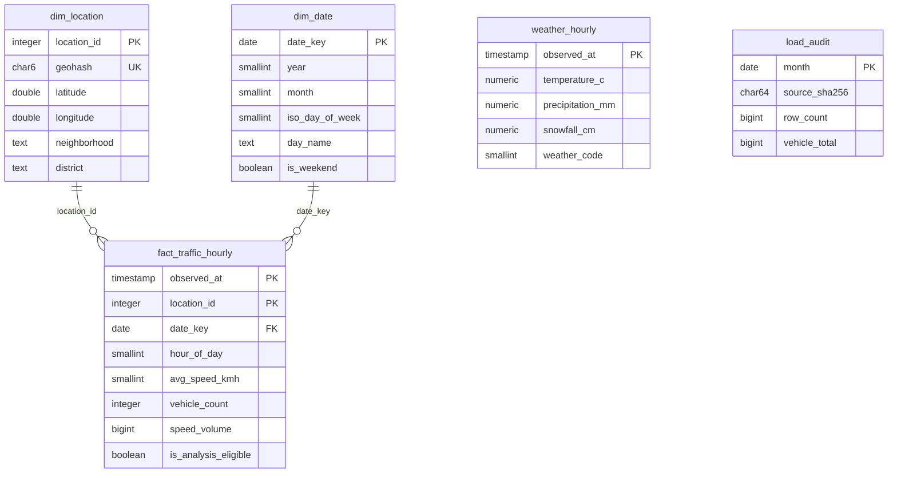

# Veritabanı

PostgreSQL 18, Docker Compose ile çalışır. Şema iki dosyadadır ve her yüklemede güvenle yeniden uygulanabilir:

- [`001_traffic.sql`](../database/schema/001_traffic.sql): yıldız şema, aylık bölümler, yükleme denetimi
- [`002_aggregates.sql`](../database/schema/002_aggregates.sql): takvim dönemleri ve özet katman

## Veri modeli



## Tasarım kararları

| Karar | Gerekçe |
|---|---|
| Yıldız şema | Konum ve takvim bilgisi tekrar etmez, analitik JOIN'ler sade kalır |
| Aylık range partition | Bir ay tek işlemde değiştirilir, tarih filtreli sorgular yalnızca ilgili bölümü okur |
| Üretilen sütunlar | `date_key`, `hour_of_day` ve `speed_volume` tek yerde hesaplanır, tutarsız olamaz |
| `CHECK` kısıtları | Hatalı veri uygulama katmanını aşsa bile veritabanına giremez |
| `load_audit` tablosu | Hangi dosyanın ne zaman yüklendiği SHA-256 özetiyle izlenir |

`speed_volume`, araç ağırlıklı ortalamanın payıdır: `SUM(speed_volume) / SUM(vehicle_count)`.

## Yükleme akışı

```bash
python -m traffic_etl.load --month 2024-10
```

1. Parquet özeti `load_audit` ile karşılaştırılır. Aynı dosya tekrar yüklenmez.
2. Aylık bölüm ve takvim satırları oluşturulur.
3. Veri `COPY` ile geçici tabloya aktarılır.
4. Yeni konumlar eklenir. Bir geohash'in koordinatı değişmişse yükleme durur.
5. Ayın bölümü boşaltılır ve yeniden doldurulur.
6. Satır ve araç toplamları kaynakla karşılaştırılır.
7. Ayın özet satırları silinip ham tablodan yeniden hesaplanır.

Adım 2-7 tek işlemde çalışır. Herhangi bir hata önceki veriyi ve özetleri olduğu gibi bırakır. Yükleme atlandığında ayın özetleri eksikse yalnızca özetler yeniden üretilir.

## Özet katmanı

| Tablo | Satır (25 ay) | İçerik |
|---|---:|---|
| `agg_city_hourly` | 16.965 | Şehrin her saati için uygun satır, araç, hız-hacim toplamı ve gün bayrakları |
| `agg_city_speed_band` | 83.605 | Hız bantlarının satır ve araç toplamı |
| `agg_location_daily` | 1.764.058 | Her hücrenin her günü için toplamlar, gece ve hafta içi akşam zirvesi toplamları |
| `calendar_period` | 37 | Resmî tatiller, Ramazan, yarıyıl, ara tatil ve yaz tatili tarihleri |

Ham tabloyla aynı sorgu karşılaştırıldı: 2024 yılının saatlik hız profili ham tablodan 5.397 ms, özet katmandan 5,6 ms sürdü ve 24 saatin değerleri birebir aynı çıktı. Özetlerin toplam boyutu 216 MB, ham tablonun 6,4 GB'tır.

Resmî tatil tarihleri hem ETL'deki Python takviminde hem de `calendar_period` tablosunda bulunur. Bir entegrasyon testi iki listenin aynı olduğunu doğrular.

## İndeks kararları

Her indeks, aynı sorgu indeksli ve indekssiz çalıştırılarak ölçüldü. Değerler 9 çalıştırmanın medyanıdır.

| İndeks | Örnek sorgu | İndekssiz | İndeksli | Kazanç | Boyut | Karar |
|---|---|---:|---:|---:|---:|---|
| `ix_fact_date_hour` | Belirli gün ve saat | 81,59 ms | 0,79 ms | 103 kat | 12 MB | Tutuldu |
| `ix_fact_location_time` | Bir konumun haftalık serisi | 1,61 ms | 0,43 ms | 3,7 kat | 73 MB | Tutuldu |
| `ix_fact_eligible_hour` | Akşam zirvesi toplamı | 56,87 ms | 46,69 ms | 1,2 kat | 92 MB | **Kaldırıldı** |

Üçüncü indeks 92 MB yer kaplamasına rağmen `ix_fact_date_hour` indeksine göre belirgin bir kazanç sağlamadı.

## 25 ay sonucu

| Ölçüm | Değer |
|---|---:|
| Ay | 25 (Ocak 2023 - Ocak 2025) |
| Satır | 40.087.669 |
| Konum hücresi | 2.464 |
| Kesintili saat | 244 |
| Ham tablo ve indeksler | 6,4 GB |
| Özet katman | 216 MB |
| Bir ayın yüklenmesi | 70-100 sn |

Denetim kaydı, ham tablo ve üç özet tablo satır, araç ve hız-hacim toplamlarında birebir eşleşti.

## Ekim 2024 sonucu

| Ölçüm | Değer |
|---|---:|
| Yüklenen satır | 1.769.643 |
| Konum | 2.458 |
| Yükleme süresi | 68 sn |
| Tablo boyutu | 129 MB |
| İndeks boyutu | 153 MB |
| Toplam boyut | 283 MB |

## Doğrulama

- Satır sayısı, araç toplamı, üç hız sütununun toplamı, konum sayısı ve 7 işaret sütunu Parquet dosyasıyla birebir eşleşti.
- Boşta kalan konum referansı bulunmadı.
- Veritabanı sıfırdan kurulup yeniden yüklendiğinde 13 analiz sonucu birebir aynı çıktı.
- 15 entegrasyon testi; yeniden yükleme, hata anında geri alma ve veritabanı kısıtlarını geçici veritabanlarında sınar.
