# Keşifsel Veri Analizi Raporu: Ekim 2024

**Kaynak kod:** [`notebooks/01_exploratory_analysis.ipynb`](../notebooks/01_exploratory_analysis.ipynb)

**Yöntem:** Aksi belirtilmedikçe kısmi saatler ve hız aykırıları çıkarılmıştır. Şehir geneli hızlar araç ağırlıklıdır. Konumlar yol segmenti değil, yaklaşık 610 m × 920 m boyutunda geohash hücreleridir.

## Yönetici özeti

1. **Araç arttıkça hız düşüyor, ama toplu veri bunu gizliyor.** Tüm gözlemlerde korelasyon -0,059 iken hücre içi medyan korelasyon -0,451'dir.
2. **Akşam zirvesi günün en yavaş dönemidir.** Hafta içi 18:00'de ortalama hız 43,9 km/sa'tir.
3. **Trafik örüntüsü öngörülebilirdir.** 18:00 hızı hafta içi günler arasında yalnızca 0,63 km/sa standart sapma gösterir.
4. **Tıkanıklık merkezde yoğunlaşır.** Hücrelerin %9,5'inde akşam hızı gece hızının yarısının altına iner.
5. **Eksik veri rastgele değildir.** Sakin hücrelerde ve gece saatlerinde daha fazla satır eksiktir.

## 1. Veri kapsamı

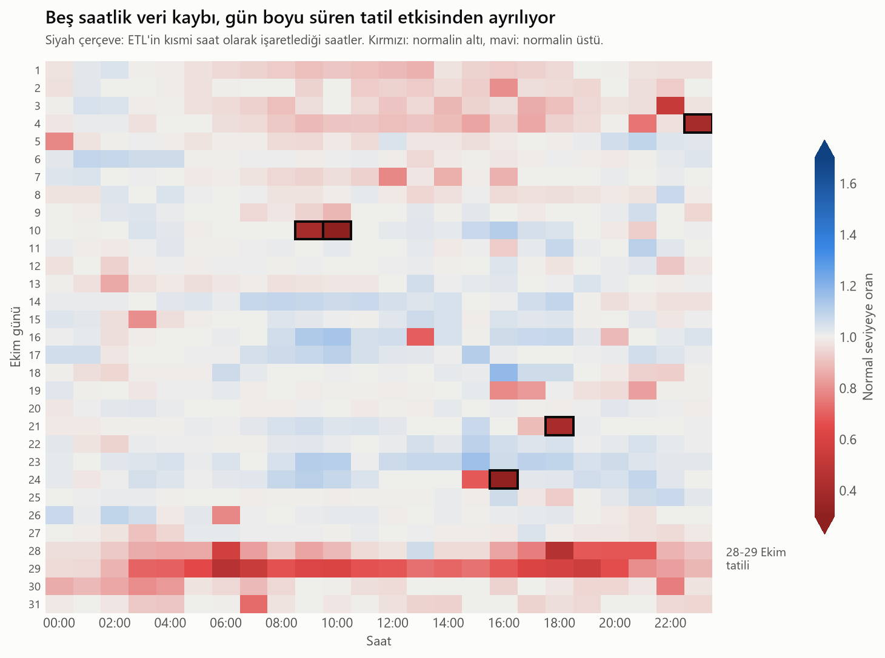

ETL'in işaretlediği beş kısmi saat, tek saatlik keskin düşüşler olarak ayrışır. 28-29 Ekim'deki düşüş ise saatlere yayılır ve tatil etkisidir. Daha hafif tek saatlik düşüşler %50 eşiğinin altında kalmadığı için işaretlenmemiştir.

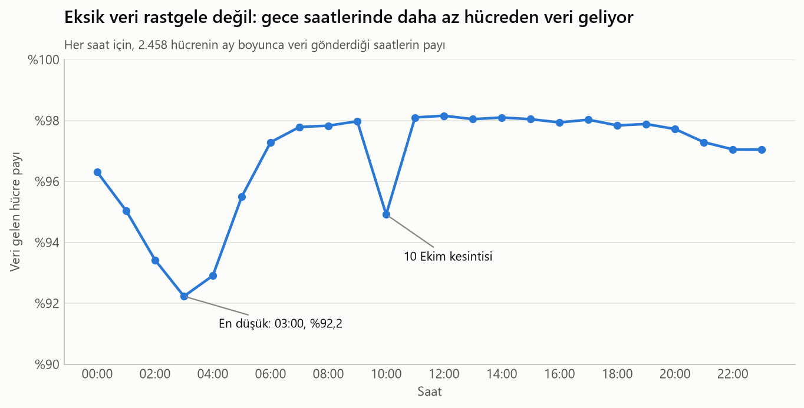

Veri gelen hücre payı gündüz yaklaşık %98, 03:00'te %92,2'dir. Hücrelerin %81,9'u ayın en az %99'unda veri üretir. Kapsama ile araç sayısı arasındaki sıra korelasyonu 0,752'dir. Kapsaması %50'nin altındaki 54 hücre, satırların yalnızca %0,38'ini oluşturur.

**Karar:** Eksik saatler sıfır araçla doldurulmaz.

## 2. Dağılımlar

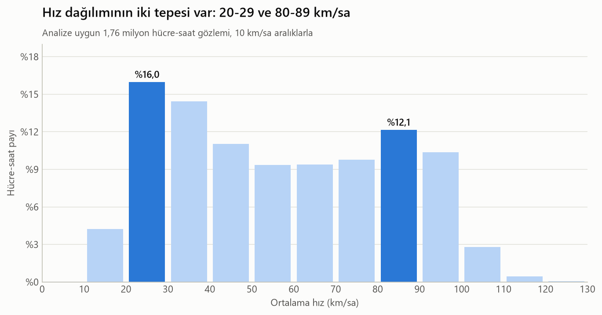

Hız dağılımının 20-29 km/sa (%16,0) ve 80-89 km/sa (%12,1) aralıklarında iki tepesi vardır. Tek bir şehir ortalaması tipik bir hücreyi temsil etmez.

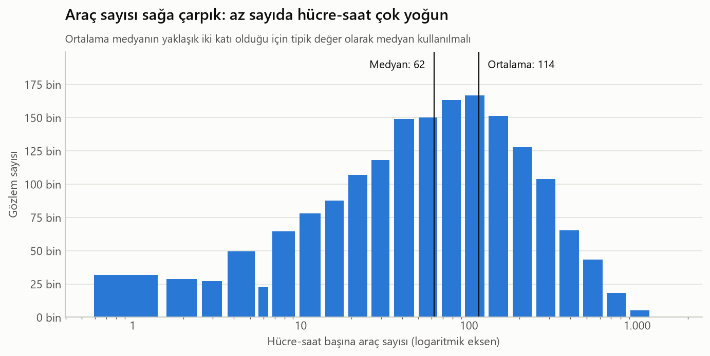

Araç sayısı sağa çarpıktır: medyan 62, ortalama 114 araçtır.

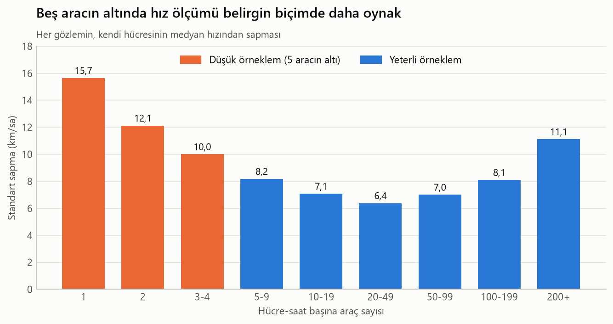

Tek araçlı gözlemlerde hücre medyanından sapmanın standart sapması 15,7 km/sa'dir. 5-9 araçta 8,2 km/sa'e iner. Bu sonuç ETL'deki 5 araç eşiğini destekler. 200 ve üzeri araçta sapmanın yükselmesi ise yoğun hücrelerde hızın gün içinde gerçekten değişmesinden kaynaklanır.

## 3. Zaman örüntüleri

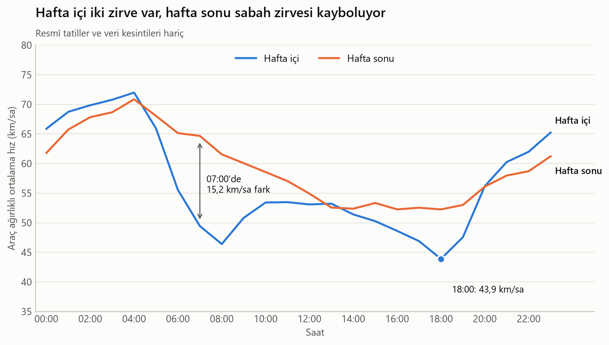

Hafta içi hız 08:00'de 46,4 km/sa, 18:00'de 43,9 km/sa ile iki kez dibe vurur. Hafta sonu sabah zirvesi yoktur ve 07:00'deki fark 15,2 km/sa'tir.

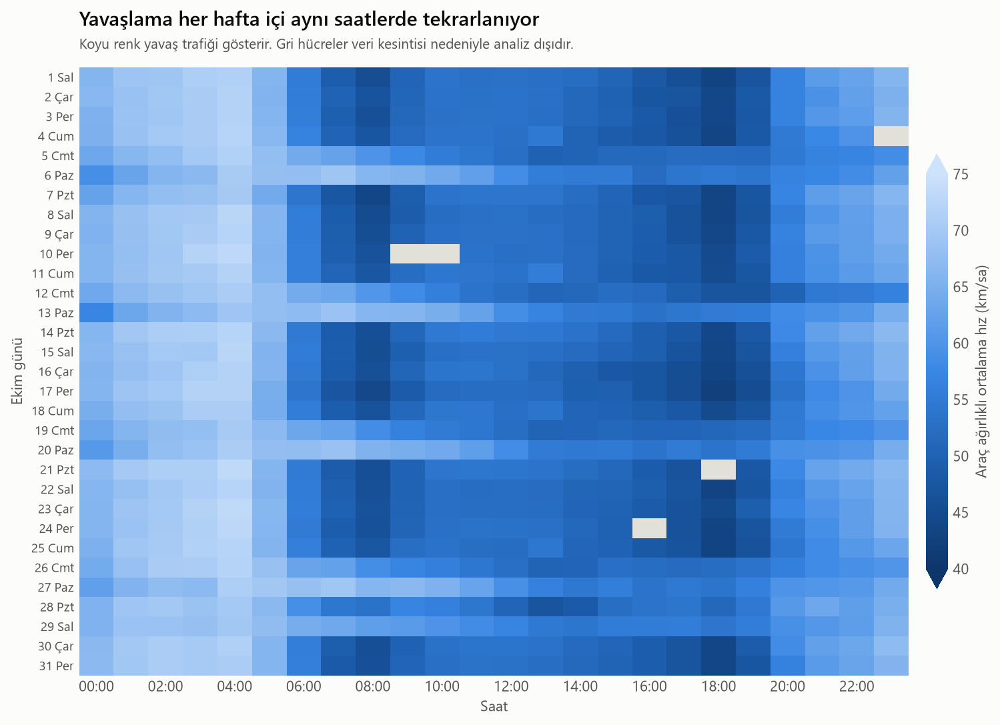

Yavaşlama her hafta içi aynı saatlerde tekrarlanır. Hafta içi günler arasındaki standart sapma 18:00'de 0,63 km/sa, 08:00'de 1,81 km/sa'tir. Sabah trafiği günden güne daha değişkendir.

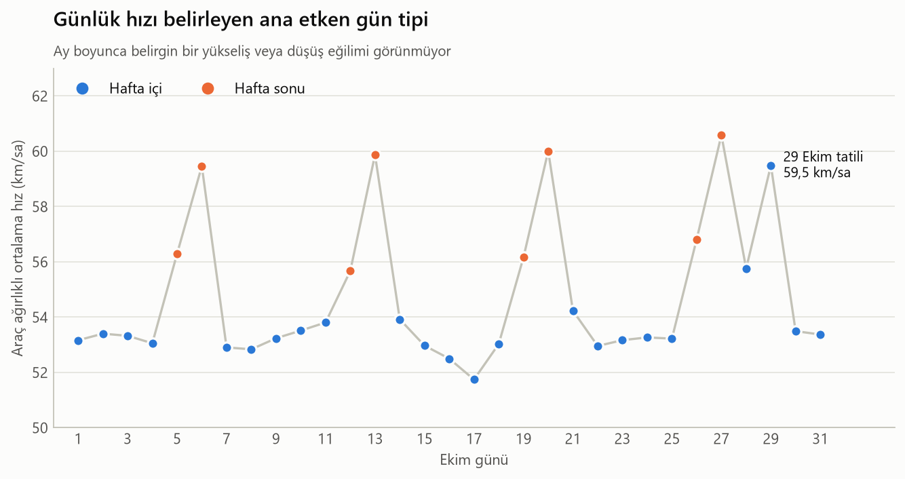

Günlük hızı en çok gün tipi belirler. Pazar günleri 59-61 km/sa seviyesindedir. 29 Ekim tatili salı olmasına rağmen 59,5 km/sa ile pazar günlerine yaklaşır.

## 4. Araç sayısı ve hız ilişkisi

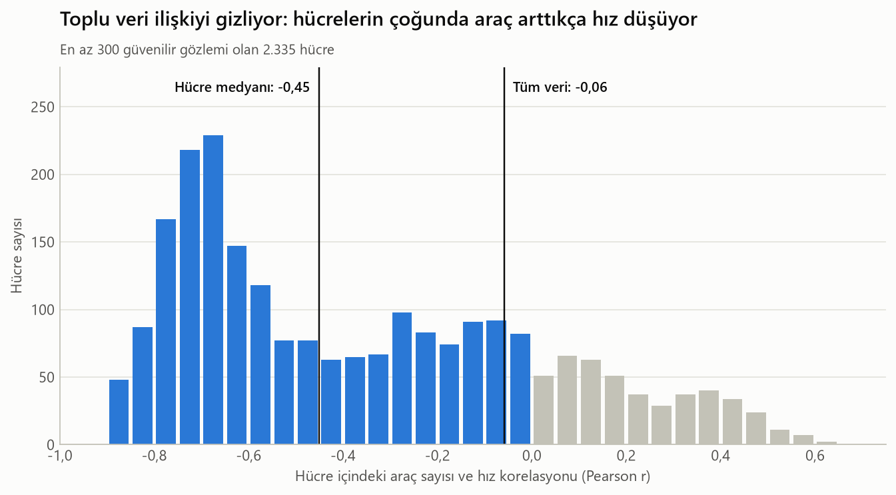

Bu analizin en önemli bulgusu bir **Simpson paradoksudur**. Tüm gözlemler birlikte incelendiğinde ilişki neredeyse yoktur (-0,059). En az 300 güvenilir gözlemi olan 2.335 hücre ayrı ayrı incelendiğinde hücrelerin %80,6'sında ilişki negatiftir ve medyan korelasyon -0,451'dir. İlişki en sakin hücre çeyreğinde -0,141, en yoğun çeyrekte -0,660'tır.

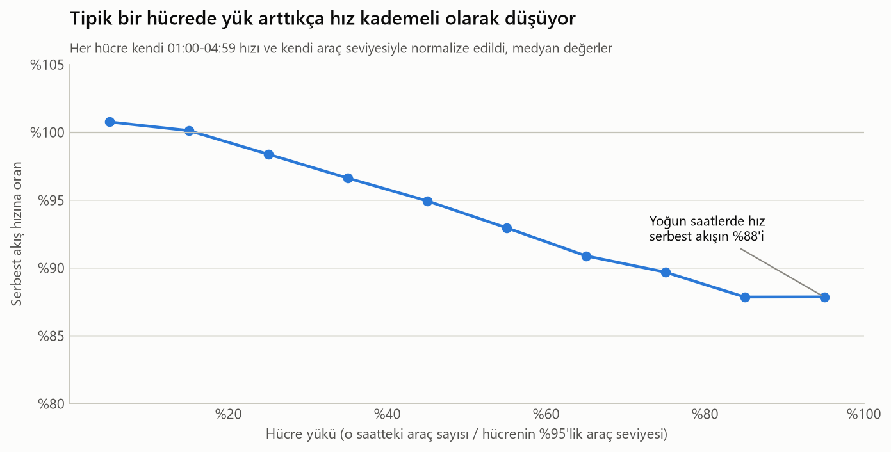

Her hücre kendi serbest akış hızı ve kendi araç seviyesiyle normalize edildiğinde, yük arttıkça medyan hız serbest akışın yaklaşık %100'ünden %88'ine iner.

## 5. Mekânsal dağılım

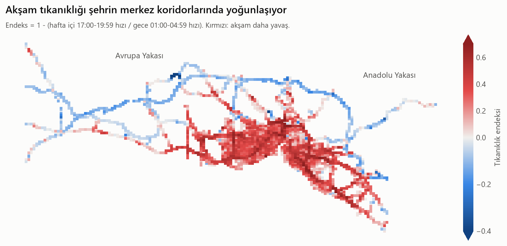

Boylam 28,7-29,3 arasındaki merkez bantlarda medyan tıkanıklık endeksi 0,24-0,29'dur. 2.320 hücrenin 221'inde (%9,5) endeks 0,5'in üzerindedir. 662 hücrede (%28,5) endeks negatiftir ve bu hücreler haritada dış koridorlar boyunca dizilir. Veride araç tipi bulunmadığı için bu durumun nedeni doğrulanamaz.

## Dashboard kararları

| Bulgu | Karar |
|---|---|
| Kesintiler tek saatlik | Kısmi saatler varsayılan olarak hesap dışıdır |
| Basit ortalama yoğun saatleri hızlı gösterir | Şehir metrikleri araç ağırlıklıdır |
| Hız dağılımı iki tepeli | Ortalamanın yanında hız bandı dağılımı gösterilir |
| Araç sayısı çarpık | Ölçekler logaritmik veya yüzdelik dilimlidir |
| 5 aracın altı oynak | Konum sıralamalarında düşük örneklem filtrelenir |
| Gün tipi örüntüyü değiştirir | Hafta içi, hafta sonu ve tatil filtresi eklenir |
| Toplu korelasyon yanıltıcı | Araç-hız ilişkisi seçili konum için gösterilir |
| Tıkanıklık mekânsal olarak kümelenir | Harita tıkanıklık endeksiyle renklendirilir |

## Doğrulama

Notebook'un son bölümü, bu rapordaki 20 temel sayıyı veriden yeniden hesaplar. Saatlik profil, hafta içi ve hafta sonu hızları ile şehir ortalaması Aşama 3'teki SQL sonuçlarıyla karşılaştırılır. Herhangi bir fark notebook'u hata vererek durdurur.

## Sınırlamalar

- Analiz tek aya aittir, mevsimsel sonuç çıkarılamaz.
- Veri, İBB'nin topladığı araç örneklemini yansıtır ve toplam trafik hacmini temsil etmez.
- Hücreler yol segmentlerine birebir karşılık gelmez.
- Korelasyonlar nedensellik göstermez.
