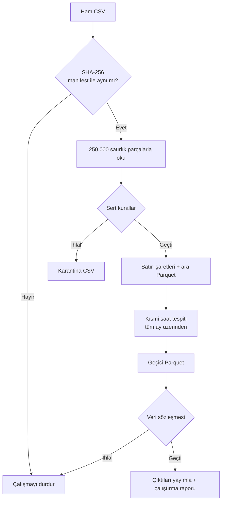

# ETL Hattı

Ham aylık CSV dosyasını doğrulanmış, tipli ve işaretli bir Parquet dosyasına dönüştürür.

```bash
python -m traffic_etl.transform --month 2024-10
```

Birden çok ayı indirip temizleyen ve yükleyen tek komut:

```bash
python -m traffic_etl.run --from 2023-01 --to 2025-01
```

Her adım kendi başına tekrar çalıştırılabilir. Doğrulanmış indirme tekrar yapılmaz, var olan Parquet yeniden üretilmez, değişmemiş dosya ikinci kez yüklenmez. Bu yüzden yarıda kalan bir çalışma aynı komutla kaldığı yerden sürer. `--force` aynı ayları baştan işler.

## Akış



## Semt adları

Veri setindeki konumlar geohash hücreleridir (`sxk973` gibi) ve okuyucuya bir şey ifade etmez. [`traffic_etl.place_names`](../etl/src/traffic_etl/place_names.py) her hücre merkezinin hangi mahalle ve ilçede kaldığını OpenStreetMap idari sınırlarından (`admin_level` 8 ve 6) Overpass API ile bulur:

```bash
python -m traffic_etl.place_names build   # Overpass'a sorar, CSV'yi yeniden yazar
python -m traffic_etl.place_names apply   # adları veritabanına yazar
```

- Sonuç [`database/reference/location_names.csv`](../database/reference/location_names.csv) olarak repoya eklenir. Normal bir ETL çalışması ağa çıkmaz, yükleyici her ay bu dosyadan `dim_location.neighborhood` ve `district` sütunlarını doldurur.
- Merkezi denize düşen hücreler (köprüler, sahil yolları) 1,5 km içindeki en yakın adlandırılmış hücrenin adını alır. Dosyanın `source` sütunu bunu `nearest` olarak işaretler.
- Mahalle adlarındaki "Mahallesi" eki atılır. Adlar © OpenStreetMap katkıcıları, ODbL lisansıyla.

## Hava durumu

[`traffic_etl.weather`](../etl/src/traffic_etl/weather.py), Open-Meteo'nun geçmiş hava arşivinden (ERA5 tabanlı, CC BY 4.0) saatlik sıcaklık, yağış, kar ve hava kodunu çeker ve `traffic.weather_hourly` tablosuna yazar. `traffic_etl.run` yüklediği ayların havasını kendiliğinden çeker; `--skip-weather` ile atlanabilir, servis yanıt vermezse trafik yüklemesi yine tamamlanır.

```bash
python -m traffic_etl.weather            # yüklü tüm aylar
```

- Değerler şehrin üç noktasının (Avcılar, Fatih, Kadıköy-Ataşehir) ortalamasıdır. Hava kodu en kötü noktanınkidir.
- Open-Meteo yağışı, zaman damgasıyla biten saat için verir. Yükleyici değeri bir saat geri kaydırır: `observed_at` 18:00, 18:00-18:59 arasındaki yağışı taşır ve trafik satırlarıyla aynı saati anlatır.
- Bir noktanın değeri eksik olan saatler tahminle doldurulmaz, atlanır.

## Tasarım ilkeleri

| İlke | Uygulama |
|---|---|
| Bellek güvenliği | Dosya parça parça işlenir, tekrar kontrolü parçalar arasında da çalışır |
| Veri kaybetmeme | Her ham satır ya temiz çıktıda ya da nedeniyle karantinadadır |
| Silmek yerine işaretleme | Şüpheli ama geçerli satırlar korunur, analizde işaretle ayrılır |
| Atomik yayın | Doğrulanmayan çıktı önceki sağlam dosyanın üzerine yazılmaz |
| Tekrarlanabilirlik | Aynı girdi ve kod aynı SHA-256 özetli Parquet dosyasını üretir |
| Erken hata | Değişmiş ham dosya, beklenmeyen başlık veya %1'i aşan red oranı çalışmayı durdurur |

## Sert kurallar: karantina

Satır, ihlal ettiği ilk kuralın adıyla `traffic_rejected_YYYYMM.csv` dosyasına yazılır.

| Neden | Koşul |
|---|---|
| `missing_value` | Boş alan |
| `invalid_timestamp` | `YYYY-MM-DD HH:MM:SS` biçimine uymayan tarih |
| `timestamp_outside_month` | İşlenen ayın dışında tarih |
| `timestamp_not_on_hour` | Tam saat olmayan tarih |
| `invalid_number` | Sayı olmayan değer veya tam sayı olmayan hız ve araç değeri |
| `invalid_speed_order` | `min ≤ ortalama ≤ maks` sırasının bozulması |
| `speed_out_of_range` | Negatif hız veya 300 km/sa üzeri maksimum hız |
| `vehicle_count_out_of_range` | Araç sayısının 1 ile 1.000.000 aralığı dışında olması |
| `outside_istanbul_bounds` | İstanbul sınır kutusu dışında koordinat |
| `invalid_geohash` | 6 karakter olmayan veya geçersiz karakterli geohash |
| `coordinate_geohash_mismatch` | Koordinatın geohash hücresi dışında olması |
| `duplicate_key` | Aynı `(observed_at, geohash)` için ikinci ve sonraki satırlar |

## Yumuşak kurallar: işaretler

| Sütun | Koşul | Amaç |
|---|---|---|
| `is_weekend` | Cumartesi veya pazar | Gün tipi karşılaştırması |
| `is_public_holiday` | Resmî tatil, yarım günlerde 13:00 sonrası | Tatil etkisini ayırma |
| `is_low_sample` | Araç sayısı < 5 | Sıralamalarda güvenilirlik filtresi |
| `is_speed_outlier` | Ortalama hız > 150 km/sa | Aykırı değerleri ayırma |
| `is_max_speed_suspect` | Maksimum hız > 200 km/sa | Şüpheli maksimum hızı görünür kılma |
| `is_partial_hour` | Saat, normal seviyesinin %50'sinin altında | Veri kesintilerini ayırma |
| `is_analysis_eligible` | Kısmi saat ve hız aykırısı değil | Analizlerin varsayılan filtresi |

### Kısmi saat tespiti

Her saat, aynı gün tipi (hafta içi veya hafta sonu) ve aynı saat diliminin aylık medyanıyla karşılaştırılır. Satır sayısı veya toplam araç sayısı medyanın yarısının altına düşerse saat kısmi sayılır. Resmî tatiller medyana dahil edilmez ve tatilde düşük trafik tek başına kesinti sayılmaz.

## Çıktı şeması

| Sütun | Tip |
|---|---|
| `observed_at` | `timestamp[ms]` |
| `geohash` | `string` |
| `latitude`, `longitude` | `double` |
| `min_speed_kmh`, `max_speed_kmh`, `avg_speed_kmh` | `int16` |
| `vehicle_count` | `int32` |
| 7 işaret sütunu | `bool` |

## Ekim 2024 sonucu

| Ölçüm | Sonuç |
|---|---:|
| Ham satır | 1.769.643 |
| Temiz satır | 1.769.643 |
| Karantina | 0 |
| Analize uygun satır | 1.760.101 (%99,46) |
| Düşük örneklem | 113.575 |
| Hız aykırısı | 49 |
| Şüpheli maksimum hız | 3.063 |
| Resmî tatil satırı | 83.437 |
| Kısmi saat satırı | 9.493 |
| CSV boyutu | 142,1 MB |
| Parquet boyutu | 10,6 MB (%92,5 daha küçük) |

Makine tarafından üretilen tam rapor: [`etl-runs/traffic_clean_202410.report.json`](etl-runs/traffic_clean_202410.report.json)

### Tespit edilen kısmi saatler

| Saat | Satır | Araç | Normal seviyeye oran (araç) |
|---|---:|---:|---:|
| 4 Ekim 23:00 | 2.340 | 91.189 | %44,9 |
| 10 Ekim 09:00 | 2.371 | 156.845 | %39,5 |
| 10 Ekim 10:00 | 35 | 275 | %0,1 |
| 21 Ekim 18:00 | 2.381 | 170.231 | %39,2 |
| 24 Ekim 16:00 | 2.366 | 117.545 | %30,1 |

Bu saatlerde araç sayısı aniden düşerken ağırlıklı ortalama hız normal seviyesine yakın kalır ve trafik kısa sürede eski düzeyine döner. Gerçek bir trafik azalması hızı da yükseltirdi, bu nedenle kayıplar veri akışı kesintisi olarak yorumlanır. İBB tarafından doğrulanmış bir kesinti kaydı yoktur.

### Bilinen sınırlama

%50 eşiği yalnızca ağır kesintileri yakalar. Örneğin 3 Ekim 22:00 (%53,9) ve 24 Ekim 15:00 (%68,8) saatleri de kısmen etkilenmiş olabilir, ancak işaretlenmemiştir. Eşik daha fazla düşürülmemiştir, çünkü %62-64 seviyesindeki pazar sabahları doğal olarak düşük trafiğe sahiptir ve hafta sonu medyanı cumartesi ile pazarı birlikte içerir.

## Doğrulama

| Kontrol | Sonuç |
|---|---|
| pytest | 61 test geçti |
| Yazılan Parquet üzerinde veri sözleşmesi | 19 kontrol geçti |
| ETL kodunu kullanmayan satır satır ham veri karşılaştırması | 1.769.643 satırda 0 fark |
