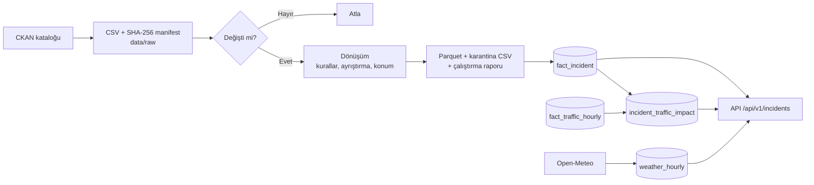

# Trafik olayları

İBB Ulaşım Yönetim Merkezi'nin (UYM) 2013'ten bu yana duyurduğu kaza, araç arızası, yol çalışması ve kapanmalar. Trafik yoğunluk verisi Ocak 2025'te bittiği halde bu veri seti aylık güncellenir; projeye güncel bir katman ekler ve 2023-2025 döneminde saatlik trafik hızıyla birleştirilir.

**Kaynak:** [Ulaşım Yönetim Merkezi Trafik Duyuruları Verisi](https://data.ibb.gov.tr/dataset/ulasim-yonetim-merkezi-trafik-duyurulari-verisi), İBB Açık Veri Lisansı
**Kod:** [`traffic_etl/incidents.py`](../etl/src/traffic_etl/incidents.py) · [`005_incidents.sql`](../database/schema/005_incidents.sql) · [`IncidentsRepository.cs`](../backend/src/IstanbulTraffic.Infrastructure/Analytics/IncidentsRepository.cs) · [`/olaylar`](../frontend/src/app/olaylar/page.tsx)

## Akış



```bash
python -m traffic_etl.incidents            # indir, dönüştür, yükle, havayı tamamla
python -m traffic_etl.incidents --force    # dosya değişmemiş olsa da yeniden kur
```

Kaynak dosya tüm geçmişi içerir ve her ay yeni satırlar eklenerek yeniden yayımlanır. Bu yüzden yükleme artımlı değil, tek işlemde tam değiştirmedir: tablo boşaltılır, yeni sürüm yazılır, satır sayısı dosyayla karşılaştırılır ve etki tablosu yeniden hesaplanır. Aynı dosyanın SHA-256 özeti `incident_load_audit` tablosunda varsa yükleme atlanır.

## Dönüşüm kuralları

| Konu | Kural |
|---|---|
| Tarih | Kaynakta milisaniyeli ve milisaniyesiz iki biçim karışık kullanılır. İkisi de saniyeye yuvarlanarak okunur. |
| Kategori | 20 ham tür 9 kategoriye indirilir: kaza, araç arızası, araç yangını, yol çalışması (bakım, yapım, altyapı, çevre düzenlemesi), yol kapanması, yoğun trafik, etkinlik, hava koşulu, diğer. Vapur sefer bildirimleri ve haberler "diğer"dir ve analizlere girmez. |
| Kaza ağırlığı | Kaza türü alanından okunur (hasarlı, yaralanmalı, zincirleme, can kaybı). Eski kayıtlarda alan boştur; o zaman duyuru başlığından okunur. |
| Yol ve kesim | Başlıktan ayrıştırılır: "D100 Acıbadem-Altunizade Yönü, sol şerit..." → yol D100, kesim "Acıbadem - Altunizade". Çok kelimeli yol adları (Sahil Yolu, Basın Ekspres Yolu) kesime karışmaz. Kesim yönlüdür. |
| Şerit | Başlıktaki "sol, orta, sağ şerit" ve "emniyet şeridi" okunur. Belirli bir şerit adı geçiyorsa "trafiğe kapalı" ifadesi tüm şeritler sayılmaz. |
| Kapanan şerit sayısı | Kaynakta 1-5 arası sayılar şerit sayısıdır; 0, -1 ve boş değerler sayı taşımaz ve boş bırakılır. |
| Süre | Açılıştan kapanışa. 1 dakikadan kısa ya da 7 günden uzun kayıtlar silinmez, ama süreleri boş bırakılır ve `is_duration_invalid` ile işaretlenir. |
| Müdahale süresi | Kayıtların %83-100'ünde müdahale zamanı kapanış zamanının aynısıdır, yani gerçek bir varış zamanı değildir. Müdahale süresi yalnızca varış kapanıştan önce ayrıca kaydedildiyse hesaplanır. |
| Konum | Her olay kendi geohash hücresine (6 karakter, yaklaşık 610 m × 920 m) atanır. Trafik verisindeki hücreyle aynıysa `location_id` dolar. Semt ve ilçe, en yakın adlandırılmış hücre merkezinden (1,5 km içinde) alınır; düzenli bir ızgarada bu, olayın düştüğü hücredir. |
| Karantina | Kimliği okunamayan, başlangıç zamanı olmayan, koordinatı İstanbul dışında kalan ve kimliği tekrar eden satırlar ayrı bir CSV'ye yazılır. |

## Kasım 2026 çalıştırması

| Ölçü | Değer |
|---|---|
| Ham satır | 264.274 |
| Temiz satır | 264.266 |
| Karantina | 8 (koordinatı İstanbul dışında) |
| Dönem | 12 Şubat 2013 - 31 Ekim 2026 |
| Kaza / arıza / yol çalışması | 126.736 / 96.419 / 29.651 |
| Kaza ağırlığı | 92.703 hasarlı, 18.590 yaralanmalı, 14.875 zincirleme, 532 can kaybı, 36 belirsiz |
| Yol ayrıştırılan | %90,7 |
| Kesim ayrıştırılan | %91,1 |
| Şerit ayrıştırılan | %73,9 |
| Semt bulunan | %99,98 |
| Süresi geçersiz | 1.675 |
| Müdahale zamanı ayrıca kaydedilen | 21.749 |
| Trafik hücresine bağlanan (2023-2025) | 48.158 olaydan 48.140 |

Ayrıntılı sayılar [çalıştırma raporundadır](etl-runs/incidents_20261101.report.json).

## Trafik etkisi

`traffic.refresh_incident_impact()` her yüklemede, trafik verisinin olduğu dönemdeki kaza, arıza ve araç yangınlarını olayın hücresindeki saatlik hızla birleştirir. Olaydan bir saat önceden üç saat sonrasına kadar her saat, aynı hücrenin aynı ay, saat ve gün tipindeki (hafta içi ya da hafta sonu) ortalama hızıyla karşılaştırılır. Olağan hız bir kez, olay yaşanan hücreler üzerinden tek geçişte hesaplanır.

| Olay | Olay saati | +1 saat | +2 saat | +3 saat |
|---|---:|---:|---:|---:|
| Araç arızası | −3,7 | −2,2 | −1,1 | −0,8 |
| Hasarlı kaza | −5,7 | −3,3 | −1,2 | −0,7 |
| Yaralanmalı kaza | −7,7 | −5,5 | −1,5 | −0,6 |
| Zincirleme kaza | −7,2 | −4,7 | −1,6 | −0,7 |
| Can kaybı olan kaza | −13,6 | −14,4 | −9,5 | −4,9 |
| Araç yangını | −10,2 | −7,0 | −2,3 | −1,3 |

km/sa, hücrenin olağan hızına göre fark. Kapatılan şerit sayısı arttıkça etki büyür: bir şerit −5,7, iki şerit −9,7, üç şerit −12,9 km/sa.

Olaydan bir saat önce de hız yaklaşık 2 km/sa düşüktür. Kazalar zaten yoğun trafikte daha sık olur ve duyurular olaydan biraz sonra açılır; bu fark nedensellik değil, seçilim etkisidir.

## Bulgular

- **En kötü akşamların nedeni çoğunlukla yağmur.** Şehrin en yavaş %10'luk iş günü akşamlarının %40'ında 17:00-19:59 arasında en az 1 mm yağmur yağdı; tüm akşamlarda bu oran %7. Ağır kaza oranı ise neredeyse aynı (%70 ve %67): ağır kazalar hemen her akşam bir yerde oluyor, şehir genelini yavaşlatan ise her yeri aynı anda etkileyen koşullar.
- **Yağmurda duyurulan kaza sayısı artmıyor.** Aynı ayın aynı saatindeki kuru saatlere göre kaza oranı hafif yağmurda 0,94, kuvvetli yağmurda 1,02, karda 0,68. Karda yola çıkan araç azalır; yağmurda trafik yavaşlar. Bu sonuç yalnızca duyurulan kazalara dayanır.
- **Kazaların yarısı yaklaşık 29 dakikada kapanıyor**, ama her on kazadan biri bir buçuk saatten uzun sürüyor.
- **D100 ve TEM olayların çoğunu taşıyor.** En çok olay yaşanan kesimler 15 Temmuz Şehitler Köprüsü (Avrupa-Anadolu yönü) ve D100 Küçükçekmece-Hacışerif'tir.

## Sınırlamalar

- Veri yalnızca UYM'nin duyurduğu olayları içerir ve ağırlıklı olarak ana yolları kapsar. Tüm kazaların resmî istatistiği değildir.
- Kayıt sayısındaki uzun dönem artışın bir kısmı izlenen yol ağının genişlemesinden gelir; yıllar arası kaza sayısı karşılaştırmaları dikkatle okunmalıdır.
- Yol, kesim ve şerit serbest metin başlıktan ayrıştırılır. Başlık kalıbına uymayan kayıtlar (%9) yol adı olmadan kalır.
- Trafik etkisi yalnızca saatlik trafik verisinin olduğu Ocak 2023 - Ocak 2025 döneminde ölçülebilir.
